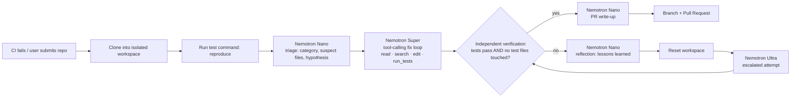

# AutoFixAI

**Red build in, verified pull request out.**

AutoFixAI is an autonomous CI-repair agent. Point it at a repository with failing tests, and it:

1. reproduces the failure in an isolated workspace,
2. triages it,
3. writes a fix in a tool-calling loop,
4. checks the fix by rerunning the real test suite itself,
5. opens a pull request explaining the root cause.

A team of **NVIDIA Nemotron** models does the work, served by **Nebius Token Factory**.

> Track: **Coding and Agentic Engineering**: an agent that writes, runs and tests code on Token Factory.

---

## Why

A red CI build blocks a whole team. Someone has to:

- open the log,
- work out which of 400 lines matters,
- check out the branch and reproduce the failure,
- find the regression, patch it and push.

Most of these failures are small: a half-finished refactor, a rounding change, a renamed field, an off-by-one. Fixing one still costs 20–60 minutes and a context switch.

AutoFixAI handles that whole loop. Nothing it produces is trusted until the project's own test command passes on a clean run. It may not edit, delete or weaken tests to get there. The result is a reviewable PR, never a direct push to your branch.

## How it works



### Model routing: the right Nemotron for each job

| Tier | Used for | Why |
|---|---|---|
| **Nemotron 3 Nano** | Log triage, reflection after a failed attempt, PR write-up | High-volume, latency-sensitive calls that need structure, not deep reasoning. Fast and cheap. |
| **Nemotron 3 Super** | The default coding agent: reads files, searches, edits, runs tests | Strong tool-calling and code reasoning at a cost that allows multi-step loops. |
| **Nemotron 3 Ultra** | Escalation only, after Super's attempt is rejected (or straight away when triage marks a failure "hard") | Deep reasoning, used only where it's needed, so credits go further. |

The dashboard shows calls, tokens and latency per tier for every run, so you can see where tokens go.

Model IDs are **resolved automatically** from Token Factory's `/v1/models` catalog at startup. The resolver prefers the generation-3 text models and skips omni, VL and embedding variants. You can pin any tier with `AUTOFIX_MODEL_NANO`, `AUTOFIX_MODEL_SUPER` or `AUTOFIX_MODEL_ULTRA`. Run `python -m autofix models` to see the resolution.

### Agent tools

The coding agent works through OpenAI-style function calling against Token Factory's OpenAI-compatible API:

| Tool | Purpose |
|---|---|
| `list_files`, `read_file`, `search` | Navigate the repo (line-numbered reads, regex search) |
| `edit_file` | Exact, unique search-and-replace edits (no fuzzy patching) |
| `write_file` | Create or overwrite a file |
| `run_tests` | Run the configured test command in the sandbox |
| `web_search` | *(optional, Tavily)* look up library changelogs, deprecations and error messages |
| `finish` | Report root cause and fix summary |

### Guardrails

- **Workspace jail:** every path is resolved inside the run's workspace, and `..` escapes and `.git` access are rejected.
- **Fixed command surface:** the only command the agent can execute is the project's test command. There is no arbitrary shell.
- **Test protection:** edits to test files are blocked at the tool layer and re-checked on the final diff. An agent can't "fix" CI by deleting assertions. Pass `--allow-test-edits` when the test itself is wrong.
- **Independent verification:** after the agent says it's done, AutoFixAI reruns the tests itself. The agent's own claim is never trusted.
- **Clean retries:** a rejected attempt resets the workspace to the baseline commit. The next attempt gets only the *lessons* from the last one, not its half-applied edits.
- **Optional container sandbox:** with `AUTOFIX_SANDBOX=docker`, tests run in a throwaway container with no network, 2 CPUs and 2 GB of RAM.
- **PRs only:** AutoFixAI pushes to a new `autofix/*` branch and opens a PR. It ignores failures on its own branches, so it can't loop.

---

## Quick start

Requirements: Python 3.10+, Node 18+, git, and a [Nebius Token Factory](https://tokenfactory.nebius.com) API key.

```bash
git clone https://github.com/Gaurav047/AutoFixAI && cd AutoFixAI
cp .env.example .env            # add NEBIUS_API_KEY

python -m venv .venv
# Windows: .venv\Scripts\activate    macOS/Linux: source .venv/bin/activate
pip install -r backend/requirements.txt

cd frontend && npm install && npm run build && cd ..

cd backend
python -m autofix models        # check which Nemotron models were resolved
python -m autofix serve         # http://127.0.0.1:8000
```

Open the dashboard, click a **demo repo**, and watch the run live.

For frontend development with hot reload, run `npm run dev` in `frontend/` (it proxies `/api` to port 8000).

### CLI

```bash
cd backend

# Fix a bundled demo
python -m autofix fix ../examples/inventory-refactor --test "python -m pytest -q"

# Fix a GitHub repo branch and open a PR (needs GITHUB_TOKEN)
python -m autofix fix https://github.com/org/repo --ref feature-x --test "pytest -q" --pr

# Feed in the original CI log for extra context, save the patch
python -m autofix fix ./my-repo --test "npm test" --ci-log failing-build.log --out fix.patch
```

### Demo repositories

`examples/` contains three small projects with realistic regressions. Each has failing tests and none ships with the fix.

| Demo | Bug | What it exercises |
|---|---|---|
| `inventory-refactor` | A v2 refactor renamed `Product.qty` → `stock` and reordered `bulk_price(quantity, unit_price)`; the service layer wasn't updated | Multi-file reasoning. The wrong argument order only fails for bulk orders. |
| `invoice-service` | Tax applied before the discount and rounded per line, so totals drift by cents | Domain reasoning (money, rounding order) |
| `rate-limiter` | Token bucket refill truncates fractional tokens and never caps at capacity | Numeric and time reasoning with a fake clock |

---

## Plugging into real CI

**Option A: GitHub Action (no server).** Copy [`examples/github-action/autofix.yml`](examples/github-action/autofix.yml) into `.github/workflows/` of any repo and add a `NEBIUS_API_KEY` secret. When the `CI` workflow fails, AutoFixAI runs inside Actions and opens a PR against the failing branch.

**Option B: Webhook (hosted).** Deploy the server and add a GitHub webhook for **Workflow runs** pointing at `https://<host>/api/github/webhook?test_command=pytest%20-q`, using `GITHUB_WEBHOOK_SECRET`. AutoFixAI then:

1. fetches the failed job's log,
2. reproduces the failure,
3. fixes it,
4. opens a PR.

Every run is visible in the dashboard.

> Note: PRs opened with the default Actions `GITHUB_TOKEN` don't trigger other workflows. Use a fine-grained PAT or GitHub App token if you want CI to run on AutoFixAI's PRs automatically.

## Deploying

The repo ships a production `Dockerfile`: a multi-stage build that compiles the React dashboard and serves it from FastAPI on `$PORT`, running as a non-root user.

```bash
docker build -t autofixai .
docker run -p 8000:8000 --env-file .env -e AUTOFIX_PUBLIC_MODE=1 autofixai
```

To host on **Nebius Serverless Endpoints**, push the image to a registry (for example Nebius Container Registry) and create an endpoint from it. Expose port `8000` and set `NEBIUS_API_KEY` and `AUTOFIX_PUBLIC_MODE=1` as environment variables. Public mode limits the hosted demo to the bundled example repositories, so strangers can't make your server run arbitrary code.

---

## Project structure

```
backend/autofix/
  llm.py         Token Factory client, Nemotron tier resolution, per-tier usage accounting
  agent.py       Pipeline: reproduce → triage → fix loop → verify → reflect/escalate → write-up
  tools.py       Function-calling tool specs + dispatcher (incl. optional Tavily web search)
  workspace.py   Isolated workspace: path jail, edits, test runner, git diff/reset
  github.py      Branch, push, PR creation, failed-job log retrieval
  server.py      FastAPI: runs API, SSE event stream, GitHub webhook, serves the dashboard
  cli.py         `python -m autofix fix | models | serve`
backend/tests/   Offline end-to-end tests (scripted fake LLM drives the real pipeline)
frontend/        React + Vite dashboard (live timeline, diff viewer, model routing panel)
examples/        Demo repos with real failing tests + drop-in GitHub Action
```

## Tests

```bash
python -m pytest backend/tests -q
```

The suite runs the **real** pipeline (workspace, tools, test execution, guardrails, escalation) against `examples/inventory-refactor`, with a scripted model standing in for Nemotron, so it needs no API key. It covers:

- a first-attempt fix,
- an attempt that tries to rewrite the tests, gets blocked by the guardrail and rejected, then fixed by Ultra after reflection,
- path-escape protection.

---

## How we used NVIDIA Nemotron and Nebius Token Factory

- **All inference runs on Nebius Token Factory** through its OpenAI-compatible endpoint (`https://api.tokenfactory.nebius.com/v1`), using the standard `openai` Python SDK.
- **Three Nemotron 3 tiers, each with a separate job** (see *Model routing* above). Escalating by tier keeps the common case fast and cheap and saves Ultra's reasoning for the failures that need it.
- **Native function calling** drives the agent loop. A JSON-in-text fallback covers deployments that return tool calls as text.
- **Structured JSON output** (`response_format`) for triage and PR write-ups, with a fallback when the parameter isn't supported.
- **Per-call reasoning control.** Nano's structured jobs run with `enable_thinking: false` (about 6× faster, and no truncated JSON). Super and Ultra keep reasoning on for the fix loop.
- **Reasoning traces** (`<think>…</think>`) are stripped before content is reused, so they never leak into PRs or tool arguments.
- **Catalog-driven model resolution:** AutoFixAI asks `/v1/models` what's available instead of hard-coding IDs, so it picks up new Nemotron releases without code changes.

## What was built during the submission period

All of it. AutoFixAI was started from an empty repository during the hackathon.

## Feedback on Nebius Token Factory and NVIDIA tools

Observations from building and testing against the live API (2026-10-26):

- **Native tool calling worked on the first try** on Nemotron 3 Super and Ultra through the OpenAI-compatible endpoint. Tool-call arguments in the agent loop were never malformed.
- **Measured results on the three demo repos:** all fixed on the first attempt.
  - Super: 20–31 s end to end, 6–9 calls, about 17–30k prompt tokens.
  - Ultra (forced escalation): fixed the rate limiter in 10.5 s.
- **Gotcha: Nano reasons by default, and the reasoning counts against `max_tokens`.** With a 1500-token cap and `response_format: json_object`, Nemotron 3 Nano returned **empty content** with `finish_reason=length`, because all 1500 tokens went to reasoning. Sending `chat_template_kwargs: {"enable_thinking": false}` produced valid JSON in 137 tokens and cut latency from 6.0 s to 1.0 s. A per-request reasoning budget, or reasoning that doesn't count toward `max_tokens`, would prevent this. So would putting this more prominently in the docs.
- **Model ID casing is inconsistent across the catalog:** `nvidia/NVIDIA-Nemotron-3-Nano-30B-A3B`, `nvidia/nemotron-3-super-120b-a12b`, `nvidia/Nemotron-3-Ultra-550b-a55b`. That makes hard-coding IDs error-prone, which is why AutoFixAI resolves them from `/v1/models`.

> _Add your own notes. Suggested prompts:_
> - _Onboarding: how long from sign-up to first successful Nemotron call?_
> - _Function calling: how reliable was tool calling on Nano, Super and Ultra? Any malformed arguments?_
> - _Latency and throughput per tier in the agent loop._
> - _Model catalog: were model IDs easy to discover? Docs gaps?_
> - _What would you want next (e.g. per-request reasoning-budget control, batch API, cost dashboard per key)?_

## License

[MIT](LICENSE)
